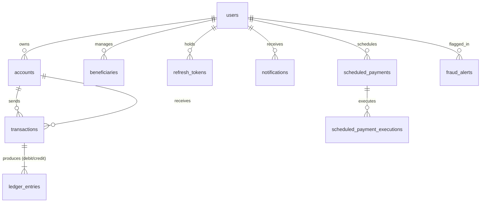

# VaultPay - Database Schema & Design Documentation

VaultPay uses **MySQL 8.0** with strict foreign keys, unique constraints, and high-precision monetary columns (`DECIMAL(19,4)`).

## Entity Relationship Overview

---

## Table Schemas

### 1. `users`
| Column | Type | Constraints | Description |
|---|---|---|---|
| `id` | BIGINT | PRIMARY KEY, AUTO_INCREMENT | Unique user identifier |
| `username` | VARCHAR(50) | NOT NULL, UNIQUE | User login name |
| `email` | VARCHAR(100) | NOT NULL, UNIQUE | Email address |
| `password_hash` | VARCHAR(255) | NOT NULL | BCrypt encrypted password hash |
| `role` | VARCHAR(20) | NOT NULL | `ROLE_CUSTOMER`, `ROLE_ADMIN`, `ROLE_SUPPORT` |
| `status` | VARCHAR(20) | NOT NULL | `ACTIVE`, `LOCKED`, `SUSPENDED` |
| `failed_attempts`| INT | NOT NULL DEFAULT 0 | Counter for failed logins |
| `lock_until` | TIMESTAMP | NULL | Time until account unlock |

### 2. `accounts`
| Column | Type | Constraints | Description |
|---|---|---|---|
| `id` | BIGINT | PRIMARY KEY, AUTO_INCREMENT | Account identifier |
| `user_id` | BIGINT | FK -> users(id) | Account holder |
| `account_number` | VARCHAR(20) | NOT NULL, UNIQUE | Formatted account # (e.g. `VP-1000101`) |
| `account_type` | VARCHAR(20) | NOT NULL | `CHECKING`, `SAVINGS`, `BUSINESS` |
| `available_balance`| DECIMAL(19,4)| NOT NULL DEFAULT 0.0000 | Instantly spendable funds |
| `ledger_balance` | DECIMAL(19,4)| NOT NULL DEFAULT 0.0000 | Settled posted funds |
| `status` | VARCHAR(20) | NOT NULL | `ACTIVE`, `FROZEN`, `CLOSED` |
| `version` | BIGINT | NOT NULL DEFAULT 0 | Optimistic locking token |

### 3. `transactions`
| Column | Type | Constraints | Description |
|---|---|---|---|
| `id` | BIGINT | PRIMARY KEY, AUTO_INCREMENT | Transaction identifier |
| `reference` | VARCHAR(64) | NOT NULL, UNIQUE | Unique business reference code |
| `idempotency_key` | VARCHAR(100) | UNIQUE | Client idempotency UUID |
| `sender_account_id` | BIGINT | FK -> accounts(id) | Sending account |
| `receiver_account_id`| BIGINT | FK -> accounts(id) | Receiving account |
| `amount` | DECIMAL(19,4)| NOT NULL | Transferred amount |
| `status` | VARCHAR(30) | NOT NULL | `PENDING`, `PROCESSING`, `SUCCESS`, `FAILED` |

### 4. `ledger_entries` (Immutable)
| Column | Type | Constraints | Description |
|---|---|---|---|
| `id` | BIGINT | PRIMARY KEY, AUTO_INCREMENT | Entry identifier |
| `transaction_id` | BIGINT | FK -> transactions(id)| Associated transfer |
| `account_id` | BIGINT | FK -> accounts(id) | Debited or credited account |
| `entry_type` | VARCHAR(10) | NOT NULL | `DEBIT` or `CREDIT` |
| `amount` | DECIMAL(19,4)| NOT NULL | Monetary delta |
| `balance_after` | DECIMAL(19,4)| NOT NULL | Snapshot of balance immediately after posting |

### 5. `beneficiaries`
| Column | Type | Constraints | Description |
|---|---|---|---|
| `id` | BIGINT | PRIMARY KEY, AUTO_INCREMENT | Beneficiary identifier |
| `user_id` | BIGINT | FK -> users(id) | Creator of beneficiary |
| `target_account_number`| VARCHAR(20)| NOT NULL | Destination account number |
| `cooling_ends_at` | TIMESTAMP | NULL | End of anti-fraud cooling period |
| `transfer_limit` | DECIMAL(19,4)| NOT NULL | Limit applicable during cooling period |

### 6. `fraud_alerts`
| Column | Type | Constraints | Description |
|---|---|---|---|
| `id` | BIGINT | PRIMARY KEY, AUTO_INCREMENT | Alert identifier |
| `rule_triggered` | VARCHAR(100)| NOT NULL | Heuristic rule name |
| `risk_level` | VARCHAR(20) | NOT NULL | `LOW`, `MEDIUM`, `HIGH`, `CRITICAL` |
| `status` | VARCHAR(20) | NOT NULL | `OPEN`, `RESOLVED_FALSE_POSITIVE`, `RESOLVED_FRAUD` |

### 7. `idempotency_records`
| Column | Type | Constraints | Description |
|---|---|---|---|
| `idempotency_key` | VARCHAR(100) | UNIQUE | Client UUID |
| `request_hash` | VARCHAR(64) | NOT NULL | SHA-256 hash of payload |
| `response_body` | TEXT | NOT NULL | Cached JSON HTTP response |
| `expires_at` | TIMESTAMP | NOT NULL | Record time-to-live |

### 8. `outbox_events`
| Column | Type | Constraints | Description |
|---|---|---|---|
| `aggregate_type` | VARCHAR(50) | NOT NULL | Aggregate name (`TRANSACTION`) |
| `event_type` | VARCHAR(100) | NOT NULL | e.g. `TransactionCompletedEvent` |
| `payload` | TEXT | NOT NULL | Serialized JSON event |
| `status` | VARCHAR(20) | NOT NULL | `PENDING`, `PUBLISHED`, `FAILED` |
